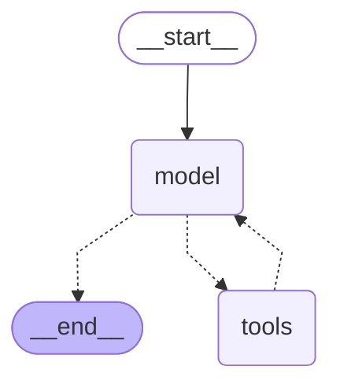

# 에이전트 안 그래프 STEP 확인

모델: google/gemma-4-26b-a4b-it · 시도 횟수: 1 · 걸린 초: 20.5 · 상태: 완료

질문: 이 뉴스 기사를 요약하고 요약한 내용과 글자수를 알려줘: https://n.news.naver.com/mnews/article/018/0006389647

| STEP | 칸 이름 | 더한 메시지 종류 | 도구 이름 | 앞부분 | 쌓인 messages 개수 |
|---|---|---|---|---|---|
| 1 | model | 도구 쪽지 | naver_news_crawl | {'news_url': 'https://n.news.naver.com/mnews/article/018/0006389647'} | 2 |
| 2 | tools | 도구 결과 | naver_news_crawl | 휴머노이드부터 로봇 두뇌까지…韓 연구진 성과 한자리  제2회 한국로봇학회 전문가 심포지엄 제조 데이터·손 조작 기술력 소개 학계·산업계 연구자  | 3 |
| 3 | model | 도구 쪽지 | get_word_length | {'text': '휴머노이드부터 로봇 두뇌까지…韓 연구진 성과 한자리\n\n제2회 한국로봇학회 전문가 심포지엄\n제조 데이터·손 조작 기술력 소 | 4 |
| 4 | tools | 도구 결과 | get_word_length | 3046 | 5 |
| 5 | model | 답 |  | ### 뉴스 분석 보고서  **1. 뉴스 요약** 한국로봇학회는 지난 15일 'AI 휴머노이드: 성과와 도약'을 주제로 제2회 전문가 심포지엄을 | 6 |

## 견주기: 2-3 도구 순서 · 오늘 STEP 순서

| 2-3 에이전트 표 도구 순서 (`out/agent_run.md`, gemma) | 오늘 STEP 순서 |
|---|---|
| naver_news_crawl → get_word_length | model → tools(naver_news_crawl) → model → tools(get_word_length) → model |
