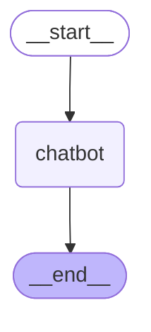
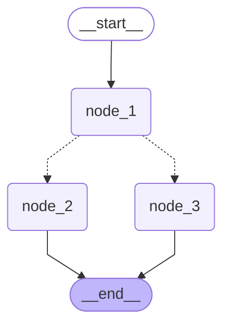

# 그래프 STEP 확인

모델: google/gemma-4-26b-a4b-it

## 채팅 그래프

| 번째 | STEP 순서 | messages 개수 | 마지막 답 앞부분 | 걸린 초 | STEP 순서가 그림의 선 위에 있는가 |
|---|---|---|---|---|---|
| 1 | chatbot | 2 | 서울에는 워낙 맛집이 많아서 'TOP 10'을 하나로 정의하기는 어렵지만, **현지인과 관광객 모두에게 꾸준히 사랑받는 상징적인 맛집**들을 카 | 6.8 | ○ |

## 갈림길 그래프

| 번째 | STEP 순서 | 마지막 graph_state | 걸린 초 | STEP 순서가 그림의 선 위에 있는가 |
|---|---|---|---|---|
| 1 | node_1 → node_3 | Hi, this is Intel I am sad! | 0.001 | ○ |
| 2 | node_1 → node_3 | Hi, this is Intel I am sad! | 0.001 | ○ |
| 3 | node_1 → node_2 | Hi, this is Intel I am happy! | 0.001 | ○ |
| 4 | node_1 → node_2 | Hi, this is Intel I am happy! | 0.001 | ○ |
| 5 | node_1 → node_3 | Hi, this is Intel I am sad! | 0.001 | ○ |
