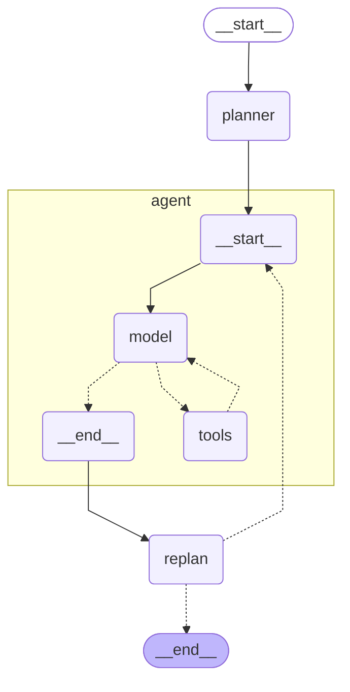

# Plan-and-Execute 그래프 STEP 확인 (planner · agent · replan)

모델: google/gemma-4-26b-a4b-it · 한도: 30 · 시도 횟수: 1 · 걸린 초: 13.5 · 상태: 완료

질문: 2024년 호주 오픈 남자 단식 우승자의 고향은 어디야? 검색해서 알려줘

| 걸음 | 칸 이름 | 계획 단계 목록 | 해낸 단계와 답 앞부분 | response 앞부분 |
|---|---|---|---|---|
| 1 | planner | 1. Search for the winner of the 2024 Australian Open Men's Singles. / 2. Identify the hometown of the winner found in step 1. |  |  |
| 2 | agent |  | Search for the winner of the 2024 Australian Open Men's Singles. → The winner of the 2024 Australian Open Men's Singles is **Jannik Sinner**. |  |
| 3 | replan | 1. Search for the hometown of Jannik Sinner. |  |  |
| 4 | agent |  | Search for the hometown of Jannik Sinner. → Jannik Sinner's hometown is **Sexten** (also known as **Sesto**), located in the |  |
| 5 | replan |  |  | 2024년 호주 오픈 남자 단식 우승자는 야닉 시너(Jannik Sinner)이며, 그의 고향은 이탈리아 남티롤 주의 섹스텐(Sexten, 이탈 |

| 사람이 확인 | 결과 |
|---|---|
| 다시 세운 계획이 해낸 단계를 보고 바뀌었나 | ○(3번 걸음에서 찾은 이름이 계획에 들어갔다) |
