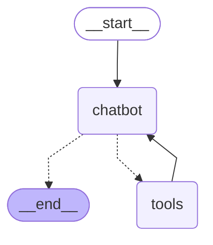

# 검색 도구 그래프 STEP 확인 (도구 칸 · 갈림길 손으로 짜기)

모델: google/gemma-4-26b-a4b-it · 시도 횟수: 1 · 걸린 초: 5.1 · 상태: 완료

질문: 한국의 다음 대통령 선거를 검색해서 알려줘

| STEP | 칸 이름 | 더한 메시지 종류 | 검색어 | 결과 제목 | 앞부분 | 답이 검색 결과에 있는 말인가 |
|---|---|---|---|---|---|---|
| 1 | chatbot | 도구 쪽지 | 대한민국 차기 대통령 선거 일정 |  | {'query': '대한민국 차기 대통령 선거 일정'} |  |
| 2 | tools | 도구 결과 | 대한민국 차기 대통령 선거 일정 | 대한민국 제22대 대통령 선거 - 위키백과, 우리 모두의 백과사전; 대한민국 제21대 대통령 선거 - 위키백과, 우리 모두의 백과사전; 제21대 대통령 선거 - 나무위키 | \|  \|  \| 대한민국 제22대 대통령 선거 \| \| \| 대한민국 전 지역 – 2030-03-27 \| \| 앞으로 1262일 \| \| 현지 시각 (새 |  |
| 3 | chatbot | 답 |  |  | 대한민국의 다음 대통령 선거에 대한 정보는 다음과 같습니다.  **제22대 대통령 선거** * **예정 일자:** 2030년 3월 27일 (수요 |  |

## 기성품 판 (ToolNode · tools_condition)

모델: google/gemma-4-26b-a4b-it · 시도 횟수: 1 · 걸린 초: 6.5 · 상태: 완료

| STEP | 칸 이름 | 더한 메시지 종류 | 검색어 | 결과 제목 | 앞부분 | 답이 검색 결과에 있는 말인가 |
|---|---|---|---|---|---|---|
| 1 | chatbot | 도구 쪽지 | 한국 다음 대통령 선거 날짜 |  | {'query': '한국 다음 대통령 선거 날짜'} |  |
| 2 | tools | 도구 결과 | 한국 다음 대통령 선거 날짜 | 다음 대통령 선거일 2030년 3월 27일? 2027년으로 기억하면 틀립니다 : 네이버 블로그; 대한민국 제22대 대통령 선거 - 위키백과, 우리 모두의 백과사전; 대한민국 제21대 대통령 선거 - 위키백과, 우리 모두의 백과사전 | ​  저라면 달력에는 2030년 3월 27일 수요일, 정상 임기 기준 다음 대통령 선거일이라고 적겠습니다. 그리고 2029년 하반기부터는 중앙선 |  |
| 3 | chatbot | 답 |  |  | 한국의 다음 대통령 선거에 대한 정보는 다음과 같습니다.  **1. 정기 선거 (정상 임기 기준)** 현재의 대통령 임기가 변동 없이 정상적으로 |  |

## 두 판 STEP 순서

손 판: 1 chatbot 도구 쪽지 → 2 tools 도구 결과 → 3 chatbot 답 · 기성품 판: 1 chatbot 도구 쪽지 → 2 tools 도구 결과 → 3 chatbot 답
