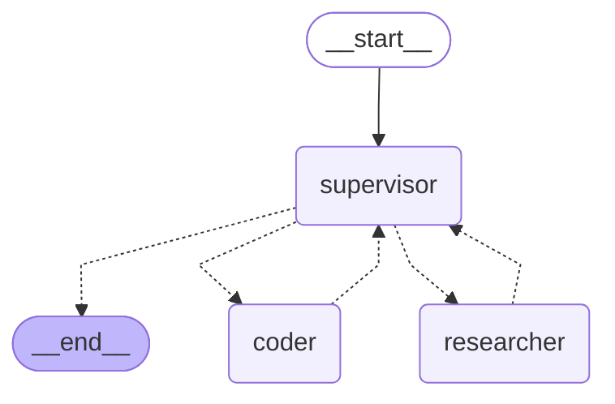

# supervisor 그래프 STEP 확인 (researcher · coder)

모델: google/gemma-4-26b-a4b-it · 시도 횟수: 1 · 걸린 초: 5.6 · 상태: 완료

질문: 뉴욕주와 캘리포니아주의 최신 GDP를 검색해서 찾아줘. 그다음 두 값의 평균은 coder 가 파이썬 코드를 실행해서 계산해줘



| 걸음 | 그래프 | 칸 이름 | 더한 것 종류 | 검색어 | 실행한 코드 | 앞부분 |
|---|---|---|---|---|---|---|
| 1 | 바깥 | supervisor | 고름 → researcher |  |  |  |
| 2 | 일꾼 안 (researcher) | model | 도구 쪽지 | latest GDP of New York state and California state |  | {'query': 'latest GDP of New York state and California state'} |
| 3 | 일꾼 안 (researcher) | tools | 도구 결과 | latest GDP of New York state and California state |  | \| Metric \| California \| New York \|  ---  \| Population \| 39.4 million \| 20.0 mill |
| 4 | 일꾼 안 (researcher) | model | 답 |  |  | 검색 결과에 따르면, 최신 데이터(2025년 기준 자료 포함)는 다음과 같습니다.  *   **캘리포니아주 (California):** 약 $4 |
| 5 | 바깥 | researcher | 사람 메시지 (researcher) |  |  | 검색 결과에 따르면, 최신 데이터(2025년 기준 자료 포함)는 다음과 같습니다.  *   **캘리포니아주 (California):** 약 $4 |
| 6 | 바깥 | supervisor | 고름 → FINISH |  |  |  |

## 요약

- 고른 차례: researcher → FINISH
- 일꾼마다 부른 수: researcher 1번, coder 0번
- 같은 일꾼을 잇달아 부른 수: 0
- 걸린 초: 5.6

| 사람이 확인 | 결과 |
|---|---|
| 평균이 researcher 답의 두 값으로 계산됐나 | ✕(coder 가 돌지 않았다) |

## 되풀이 한도 2

모델: google/gemma-4-26b-a4b-it · 한도: 2 · 시도 횟수: 1 · 걸린 초: 8.2 · 상태: 한도에서 멈춤

| 걸음 | 그래프 | 칸 이름 | 더한 것 종류 | 검색어 | 실행한 코드 | 앞부분 |
|---|---|---|---|---|---|---|
| 1 | 바깥 | supervisor | 고름 → researcher |  |  |  |
| 2 | 일꾼 안 (researcher) | model | 도구 쪽지 | latest GDP of New York state and California state 2023 2024 |  | {'query': 'latest GDP of New York state and California state 2023 2024'} |
| 3 | 일꾼 안 (researcher) | tools | 도구 결과 | latest GDP of New York state and California state 2023 2024 |  | When examining the U.S. states GDP ranking from 2001 to 2024, the top of the lea |
| 4 | 일꾼 안 (researcher) | model | 답 |  |  | ```python # 캘리포니아와 뉴욕의 최신 GDP (Wikipedia 및 FRED 데이터 기준, 단위: $ Trillion) # Califo |
| 5 | 바깥 | researcher | 사람 메시지 (researcher) |  |  | ```python # 캘리포니아와 뉴욕의 최신 GDP (Wikipedia 및 FRED 데이터 기준, 단위: $ Trillion) # Califo |

멈춘 걸음: 5 (이 걸음 다음에 한도에 걸림)

오류: GraphRecursionError: Recursion limit of 2 reached without hitting a stop condition. You can increase the limit by setting the `recursion_limit` config key. For troubleshooting, visit: https://docs.langchain.com/oss/python/langgraph/errors/GRAPH_RECURSION_LIMIT

### 요약

- 고른 차례: researcher
- 일꾼마다 부른 수: researcher 1번, coder 0번
- 같은 일꾼을 잇달아 부른 수: 0
- 걸린 초: 8.2

| 사람이 확인 | 결과 |
|---|---|
| 평균이 researcher 답의 두 값으로 계산됐나 |  |

## 되풀이 한도 10

모델: google/gemma-4-26b-a4b-it · 한도: 10 · 시도 횟수: 1 · 걸린 초: 8.5 · 상태: 완료

| 걸음 | 그래프 | 칸 이름 | 더한 것 종류 | 검색어 | 실행한 코드 | 앞부분 |
|---|---|---|---|---|---|---|
| 1 | 바깥 | supervisor | 고름 → researcher |  |  |  |
| 2 | 일꾼 안 (researcher) | model | 도구 쪽지 | latest GDP of New York state and California state |  | {'query': 'latest GDP of New York state and California state'} |
| 3 | 일꾼 안 (researcher) | tools | 도구 결과 | latest GDP of New York state and California state |  | \| Metric \| California \| New York \|  ---  \| Population \| 39.4 million \| 20.0 mill |
| 4 | 일꾼 안 (researcher) | model | 답 |  |  | 검색 결과에 따르면, 최신 데이터(2025년 추정치 기준)는 다음과 같습니다.  *   **캘리포니아주 (California) GDP:** 약  |
| 5 | 바깥 | researcher | 사람 메시지 (researcher) |  |  | 검색 결과에 따르면, 최신 데이터(2025년 추정치 기준)는 다음과 같습니다.  *   **캘리포니아주 (California) GDP:** 약  |
| 6 | 바깥 | supervisor | 고름 → FINISH |  |  |  |

### 요약

- 고른 차례: researcher → FINISH
- 일꾼마다 부른 수: researcher 1번, coder 0번
- 같은 일꾼을 잇달아 부른 수: 0
- 걸린 초: 8.5

| 사람이 확인 | 결과 |
|---|---|
| 평균이 researcher 답의 두 값으로 계산됐나 |  |
