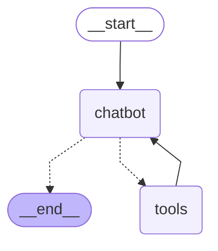

# 도구 셋 그래프 확인

모델: google/gemma-4-26b-a4b-it

| 질문 | 고른 도구 순서 | 인자 | 도구 결과 | 마지막 답 앞부분 | 모델 호출 수 | 걸린 초 | 고른 도구가 질문에 맞는가 |
|---|---|---|---|---|---|---|---|
| 주문 조회해줘 | get_order_info | get_order_info {} | get_order_info: ["스트라이프 셔츠 12,000원", "트레이닝 바지 35,000원"] | 주문하신 상품은 다음과 같습니다:  *   스트라이프 셔츠 (12,000원) *   트레이닝 바지 (35,000원)  특정 상품의 배송 정보가  | 2 | 2.7 | ○ |
| 내 등급 조회 | get_grade_info | get_grade_info {} | get_grade_info: VIP | 고객님의 현재 등급은 **VIP**입니다. | 2 | 1.2 | ○ |
| 스트라이프 셔츠 주문한거 언제와 | get_shipping_info | get_shipping_info {'product': '스트라이프 셔츠'} | get_shipping_info: 배송준비중 | 주문하신 스트라이프 셔츠는 현재 **배송 준비 중**입니다. 조금만 더 기다려 주시면 곧 발송될 예정입니다! | 2 | 1.6 | ○ |
| 내 등급이랑 주문정보 알려줘 | get_grade_info → get_order_info | get_grade_info {}; get_order_info {} | get_grade_info: VIP; get_order_info: ["스트라이프 셔츠 12,000원", "트레이닝 바지 35,000원"] | 고객님의 현재 등급은 **VIP**이며, 주문하신 상품은 다음과 같습니다.  *   **스트라이프 셔츠**: 12,000원 *   **트레이닝  | 2 | 2.6 | ○ |
| 한국의 수도가 어디야 | 없음 |  |  | 한국의 수도는 **서울**입니다. | 1 | 0.5 | ○ |
